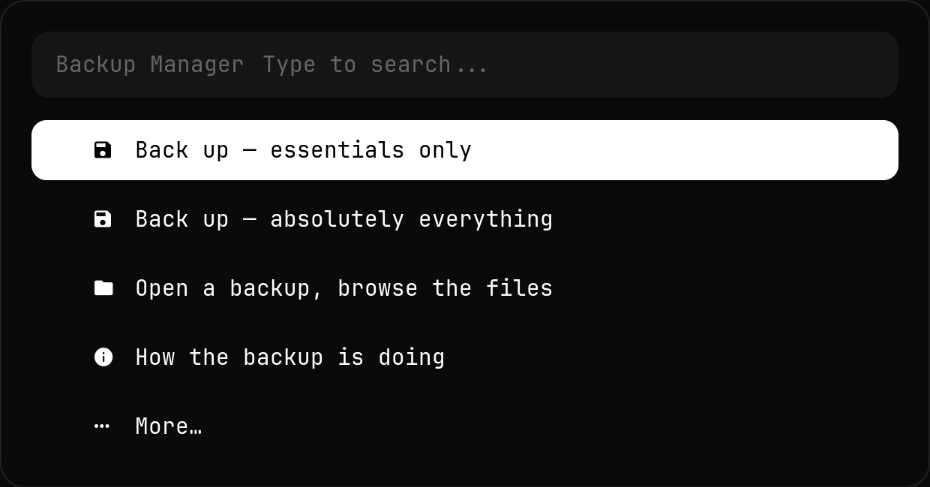
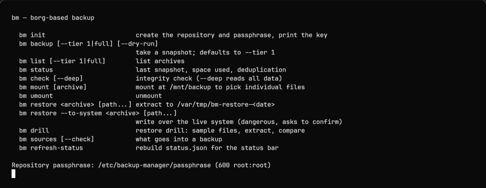
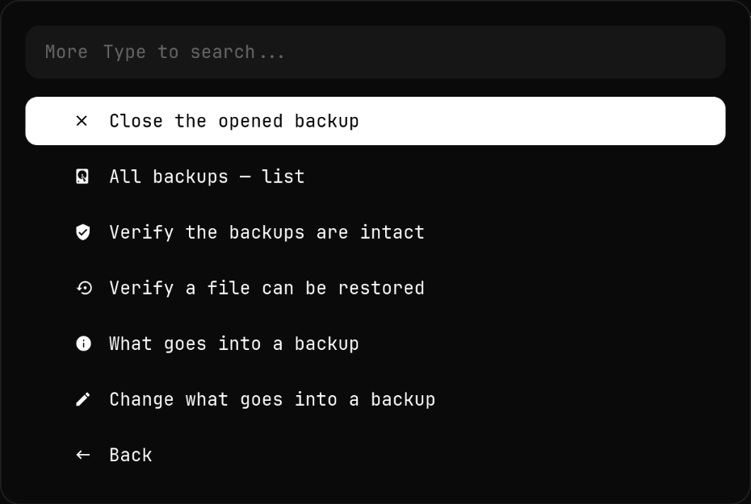
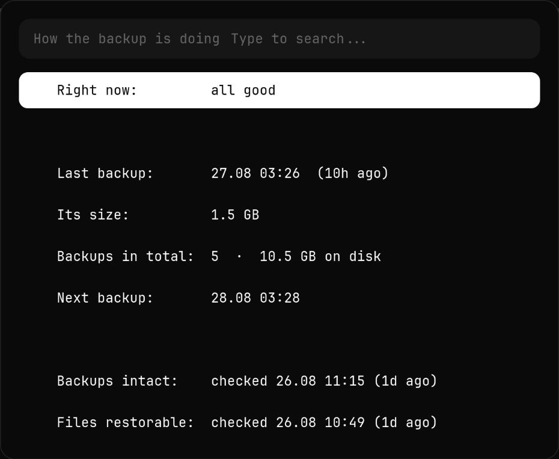

# Backup Manager

*[English version](README.md)*


Шифрованные ночные копии с дедупликацией для одной машины — обвязка вокруг
[BorgBackup](https://www.borgbackup.org/): systemd-таймеры, честный статус в
панели и ежемесячная проверка того, что копии действительно восстанавливаются.



Большинство бэкапов ни разу не проверяют до того дня, когда они понадобились.
Этот проверяет себя сам: первого числа каждого месяца берёт 50 случайных файлов
из свежего архива, извлекает их и побайтово сверяет с живой системой. Если
что-то не так — ты узнаешь об этом первого числа, а не в день смерти диска.

## Что внутри

- **Два слоя.** Слой 1 идёт каждую ночь и содержит то, что нельзя скачать
  заново: `/etc`, конфиги, ключи, код, документы. Слой 2 добавляется в
  еженедельном полном прогоне и забирает крупное и легко переживающее потерю —
  фонотеку, историю мессенджеров. Ночной прогон остаётся быстрым именно потому,
  что тяжёлого в нём нет.
- **Дедупликация.** Borg режет файлы на куски и хранит каждый кусок один раз.
  На машине, для которой это писалось, ночной прогон превратился из 2,2 ГБ за
  1 мин 45 с в **4,3 МБ за 8 секунд** — второй снимок дописывает только то, что
  реально изменилось.
- **Шифрование.** `repokey-blake2`, AES-256. Пароль лежит в
  `/etc/backup-manager/passphrase` с правами `600 root:root`. Альтернатива —
  обычный архив с `/etc/shadow` внутри и правами 644 — то, как это устроено по
  умолчанию во множестве самописных скриптов.
- **Учебное восстановление.** `bm drill` берёт выборку файлов из свежего архива,
  извлекает и сверяет с тем, что на диске. Раз в месяц, по таймеру.
- **Статус без root.** После каждого прогона `bm` пишет `status.json` (права
  644, секретов внутри нет — только имена, размеры и даты). Оттуда читают модуль
  панели и меню, поэтому просто *посмотреть* состояние никогда не требует пароля.
- **Меню.** Оболочка на rofi поверх всего этого — когда проще кликнуть, чем
  вспоминать флаги.

| | Раньше (самописный скрипт на tar.zst) | Сейчас на Borg |
|---|---|---|
| ночной прогон | 2,2 ГБ, ~1 мин 45 с | **4,3 МБ, 8 с** |
| история | 1 точка, вчерашняя затиралась | 7 дневных + 4 недельных + 6 месячных |
| шифрование | нет, архив 644 с `/etc/shadow` внутри | AES-256, `repokey-blake2` |
| промежуточные файлы | копия всего в `/var/tmp` | нет, источники читаются напрямую |

## Требования

- Linux с systemd. Установщик умеет `pacman`; на остальных дистрибутивах
  поставь `borg`, `jq` и `openssl` сам — он их подхватит.
- `borg` 1.2 или новее, `jq`, `openssl`
- Опционально: `rofi` (меню), `kitty` (действия в терминале из меню),
  `libnotify` (уведомления), `fuse3` (`bm mount`)
- Root — для всего, кроме `bm sources` и `bm --help`

## Установка

```bash
git clone https://github.com/Whyslab/backup-manager.git
cd backup-manager
sudo ./install.sh
```

Установщик кладёт код в `/opt/backup-manager`, генерирует `config/settings.json`
для того пользователя, который вызвал `sudo`, делает симлинки `bm` и
`backup-manager` в `/usr/local/bin`, ставит systemd-юниты и правила logrotate,
создаёт borg-репозиторий и предлагает включить таймеры.

**Он напечатает пароль и бумажный ключ. Запиши их там, где нет этого
компьютера.** Без них репозиторий не прочитать, даже если целы все байты. Это
единственный шаг установки, который потом нельзя отменить.

Посмотреть, что именно будет сделано, ничего не делая:

```bash
sudo ./install.sh --dry-run
```

Попробовать на временном каталоге вместо настоящей системы:

```bash
./install.sh --prefix /tmp/bm-test    # root не нужен
```

### Перед первой настоящей копией

Посмотри, что попадёт в копию — root для этого не нужен:

```bash
bm sources
```

`sources.json` идёт с разумным набором по умолчанию (конфиги, ключи,
`~/Projects`, `~/Documents`, `~/Pictures` — еженощно; `~/Music` и `~/Videos` —
раз в неделю). Поправь под свою машину и сделай первый снимок:

```bash
sudo bm backup
```

## Как пользоваться



| Команда | Что делает |
|---|---|
| `bm status` | последний снимок, сколько занято, когда проверяли |
| `bm backup` | снимок слоя 1 руками |
| `bm backup --tier full` | полный снимок (слои 1+2) |
| `bm backup --dry-run` | показать, что попадёт, ничего не записывая |
| `bm list` | список архивов |
| `bm sources` | что копируется, с размерами — **работает без root** |
| `bm check` | проверка целостности |
| `bm check --deep` | то же, с чтением всех данных |
| `bm mount` | смонтировать репозиторий в `/mnt/backup` |
| `bm umount` | отмонтировать |
| `bm restore <архив> [путь…]` | извлечь в `/var/tmp`, систему не трогая |
| `bm restore --to-system <архив>` | записать поверх системы (просит набрать `RESTORE`) |
| `bm drill` | прогнать учебное восстановление сейчас |
| `bm refresh-status` | пересобрать `status.json` для панели |

### Достать один файл

Безопасный путь вообще не трогает систему — смонтировать репозиторий и скопировать
нужное руками:

```bash
sudo bm mount                 # выбрать архив в списке или назвать его
cp /mnt/backup/<архив>/home/<user>/notes.md ~/notes-recovered.md
sudo bm umount
```

`bm restore` без `--to-system` извлекает в `/var/tmp/bm-restore-<дата>`, чтобы
можно было сравнить с живой системой прежде, чем что-то решать.

### Расписание

| Когда | Что | Юнит |
|---|---|---|
| каждый день 03:20 | снимок слоя 1 | `bm-backup.timer` |
| воскресенье 03:40 | полный снимок (слои 1+2) | `bm-full.timer` |
| понедельник 04:00 | проверка целостности | `bm-check.timer` |
| 1-го числа 04:30 | глубокая проверка + учебное восстановление | `bm-drill.timer` |

У каждого таймера `Persistent=true` — прогон, пропущенный из-за выключенного
компьютера, догонится после включения. Все идут с `Nice=19` и приоритетом
ввода-вывода `idle`, чтобы копирование не мешало работе.

### Меню

`backup-manager` открывает меню rofi над теми же командами — при желании повесь
на клавишу (писалось под `SUPER + SHIFT + B`):

```bash
bind = SUPER SHIFT, B, exec, backup-manager   # Hyprland
```




Всё, что показывает экран состояния, читается из `status.json` — открывается
мгновенно и никогда не спрашивает пароль.

## Настройка

Два файла, оба в `/opt/backup-manager/config/`:

**`sources.json`** — единственный источник правды о том, что копируется.

```json
{
  "path": "~/.config",
  "tier": 1,
  "exclude": ["**/cache2", "**/GPUCache"],
  "exclude_unless_full": ["какой-нибудь-огромный-каталог"]
}
```

- `tier: 1` — каждую ночь. `tier: 2` — только в еженедельном полном прогоне.
- `exclude` — выбрасывается всегда.
- `exclude_unless_full` — выбрасывается из ночного прогона, остаётся в полном.
- `never` (верхний уровень) — выбрасывается отовсюду.

> **Правило, которое лучше не нарушать:** включай каталог целиком и вычитай из
> него крупное. Не перечисляй нужное поимённо. При вычитающем списке новый
> каталог попадает в копию по умолчанию; при перечисляющем — молча теряется, и
> ты узнаешь об этом, когда он понадобится.

**`settings.json`** — сколько хранить, чем сжимать, где лежит репозиторий:

```json
"retention": {
  "bm-t1":   { "keep_daily": 7, "keep_weekly": 4, "keep_monthly": 0 },
  "bm-full": { "keep_daily": 0, "keep_weekly": 4, "keep_monthly": 6 }
}
```

`targets` — список, поэтому второму хранилищу есть куда встать: см. «Чего это не
умеет».

### Панель

`ui/hyprpanel_module.sh` печатает один JSON-объект и всегда завершается с кодом 0
— его можно взять в любую панель, которая умеет запускать команду (HyprPanel,
Waybar, i3blocks):

```json
{ "alt": "ok", "state": "all good", "time": "27.08 03:26", "ago": "10h ago",
  "size": "1.5 GB", "count": "5", "next": "28.08 03:28" }
```

`alt` принимает значения `ok`, `warning`, `error`, `running`, `none` — по нему
выбирается иконка. `warning` выдаётся, когда последнему снимку больше 48 часов
или целостность не проверяли три недели; `error` — когда упал юнит.

## Чего это не умеет

Об этом стоит сказать прямо: непонятый бэкап хуже отсутствующего.

- **Один диск.** По умолчанию репозиторий лежит на том же диске, что и
  оригиналы. Это спасает от «удалил файл», «сломал конфиг», «обновление всё
  испортило» — и **не спасает** от смерти диска. `targets` сделан списком именно
  затем, чтобы добавить второе хранилище, но самого второго уровня здесь нет.
- **Одна машина.** Ни удалённых репозиториев, ни `borg serve`, ни облака.
- **Пароль — единственная точка отказа.** Потерял его — копий нет, в каком бы
  состоянии они ни были на диске. Установщик говорит об этом громко, и понимать
  это стоит буквально.
- **Заточено под Arch.** Дистрибутиво-зависимы только установка зависимостей и
  `lib/packages.sh` (сохраняет списки пакетов `pacman` / AUR). Всё остальное
  переносимо.
- **Нет pre/post-хуков.** Базы данных копируются как файлы, поэтому база, в
  которую пишут в 03:20, может попасть в архив в несогласованном состоянии.

## Удаление

```bash
sudo ./uninstall.sh              # снести программу, копии оставить
sudo ./uninstall.sh --purge      # плюс логи, состояние и пароль
```

По умолчанию borg-репозиторий и пароль намеренно не трогаются: удаление
инструмента не должно уничтожать сделанные им данные. Скрипт удаления печатает
путь к репозиторию и две команды, которыми его можно прочитать вообще без этого
проекта:

```bash
export BORG_PASSCOMMAND='cat /etc/backup-manager/passphrase'
borg list /путь/к/borg-repo
```

Ради этого всё и построено на Borg, а не на своём формате: архивы переживают
обвязку.

## Разработка

```bash
bash tests/run-tests.sh
```

55 проверок: синтаксис shell, валидность JSON, что модуль панели печатает
корректный JSON в любом состоянии (файла нет, файл битый, свежий снимок,
протухший), что каждый пункт меню резолвится и обрабатывается, что установка в
песочницу откатывается начисто, что размеры не зависят от локали системы и что
в репозиторий не попало ничего личного. Набор не трогает настоящую систему и не
требует root.

## Лицензия

MIT — см. [LICENSE](LICENSE).
